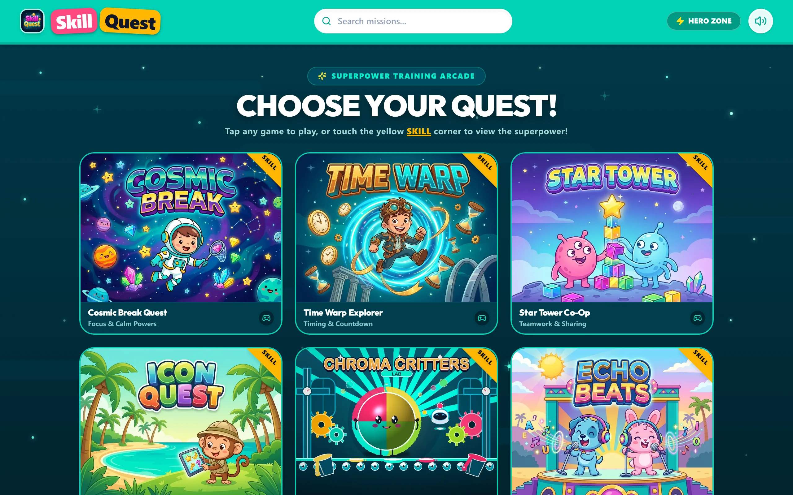
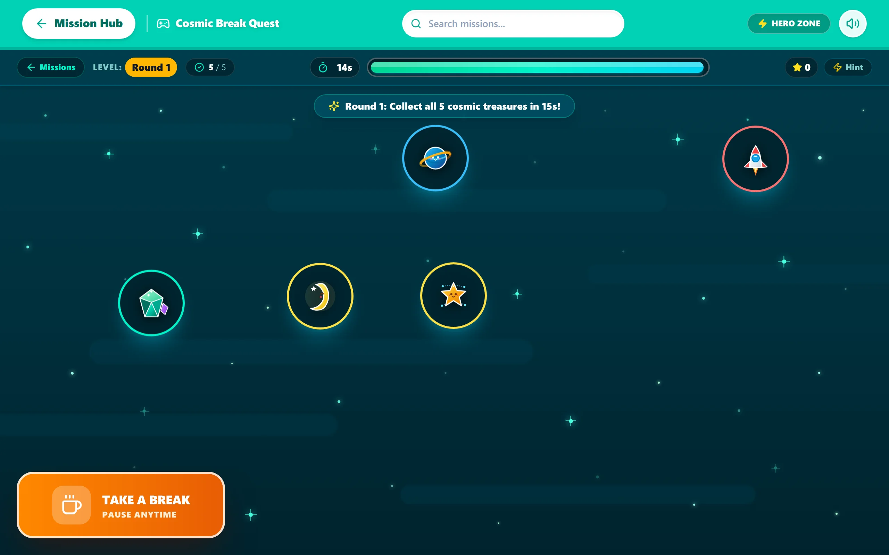
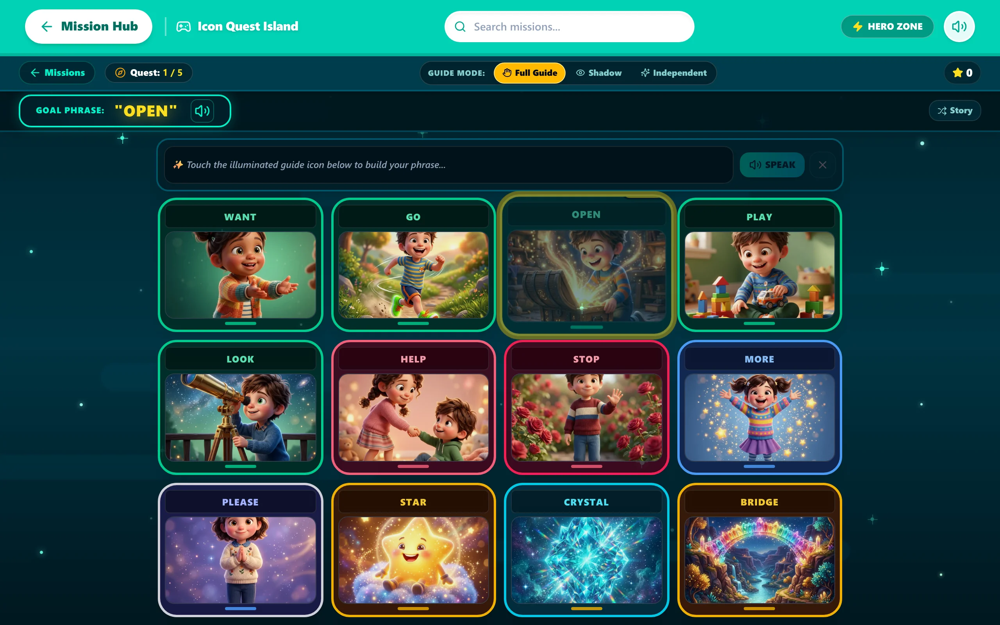
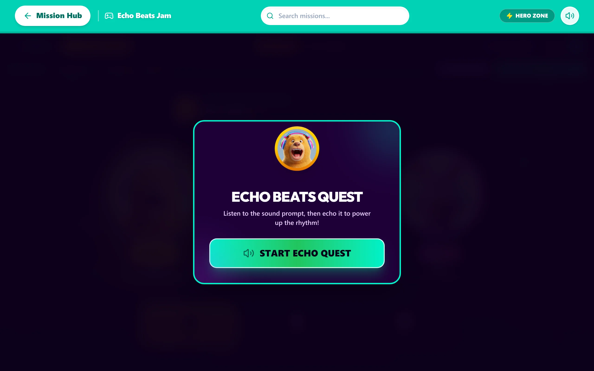
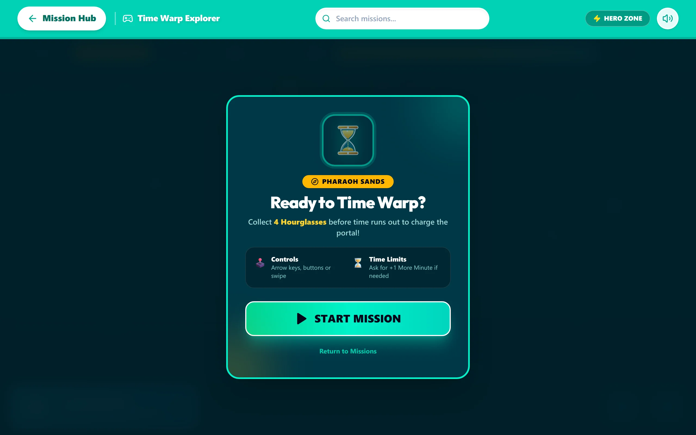

# SkillQuest 🎮✨

[](https://skill-quest.web.app)
[](https://react.dev)
[](https://www.typescriptlang.org)
[](https://tailwindcss.com)
[](https://playwright.dev)
[](https://web.dev/progressive-web-apps/)
[](./LICENSE)

> **Gamified Clinical Skill Acquisition Platform for Pediatric Therapy & Behavior Analysis (ABA / RBT).**  
> SkillQuest bridges clinical behavioral targets with arcade-quality interactive micro-games, transforming repetitive therapy drills into engaging, intrinsically motivating missions.

🔗 **Live Production App:** [https://skill-quest.web.app](https://skill-quest.web.app)

<br />

<div align="center">
  
</div>

---

## 📸 Gameplay & Clinical Modules

<div align="center">
  <table>
    <tr>
      <td width="50%" align="center">
        <strong>Mission 01: Cosmic Break Quest</strong><br />
        <em>Functional Break Request & Escape Extinction</em><br /><br />
        
      </td>
      <td width="50%" align="center">
        <strong>Mission 04: Icon Quest Island</strong><br />
        <em>AAC Symbol Grid & Guided Prompts</em><br /><br />
        
      </td>
    </tr>
    <tr>
      <td width="50%" align="center">
        <strong>Mission 06: Echo Beats Jam</strong><br />
        <em>Vocal Imitation & Echoic Studio</em><br /><br />
        
      </td>
      <td width="50%" align="center">
        <strong>Mission 02: Time Warp Explorer</strong><br />
        <em>Transition Tolerance & Time Extensions</em><br /><br />
        
      </td>
    </tr>
  </table>
</div>

---

## 🎯 Clinical Missions & Therapeutic Targets

Each game directly operationalizes an Applied Behavior Analysis (ABA) or speech therapy objective:

| Mission | Game Title | Clinical Target | Skill Code | Therapeutic Mechanism |
| :--- | :--- | :--- | :--- | :--- |
| **01** | **Cosmic Break Quest** | Functional Break Request | `Skill 11` | High task-demand timer (15s) with 25 crystals. Tapping **"Take a Break"** freezes countdown and grants bonus time, reinforcing functional communication over escape-maintained behaviors. |
| **02** | **Time Warp Explorer** | Transition Tolerance & Time Extensions | `Skill 9` | Visual countdown alerts prior to session termination. Tapping **"+1 Minute"** negotiates an extension, mitigating transition meltdowns through proactive communication. |
| **03** | **Star Tower Co-Op** | Turn-Taking & Collaborative Play | `Skills 7 & 8` | Two-player cooperative builder that disables the learner's controls during partner turns, conditioning active waiting and smooth material transfer. |
| **04** | **Icon Quest Island** | AAC Device Fluency & Guidance Acceptance | `Skill 10` | High-frequency AAC symbol grid with tactile desensitization. Rewards physical prompting and symbol discrimination with instant multi-sensory feedback. |
| **05** | **Chroma Critters Lab** | Functional Help-Seeking | `Skill 3` | Multi-layer stencil sequencing puzzle. Introducing impasses prompts players to deploy the **"Help Drone"**, teaching assertive help requests before frustration spikes. |
| **06** | **Echo Beats Jam** | Vocal Imitation & Echoics | `Skills 4 & 12` | Facilitator co-pilot triggers animated character mouth shapes and reinforces immediate phonemic approximations with celebratory rhythm sequences. |

---

## ⚡ Tech Stack & Architecture

- **Core Framework:** [React 19](https://react.dev) with strict [TypeScript](https://www.typescriptlang.org) configuration.
- **Styling:** [Tailwind CSS v4](https://tailwindcss.com) utilizing CSS theme variables and optimized build hooks.
- **Audio & Visual FX:** Web Audio API synth triggers + [Canvas Confetti](https://www.npmjs.com/package/canvas-confetti) for reinforcer celebrations.
- **Asset Optimization:** 100% lossy/lossless WebP pipeline (`public/covers/*.webp`, `public/cards/aac/*.webp`) delivering an **85% bandwidth reduction** (~1.9MB total catalog payload) for sub-second tablet load times.
- **PWA Ready:** Web App Manifest and service worker capabilities for clinical tablet deployments.
- **Testing:** Comprehensive [Playwright](https://playwright.dev) E2E suite with anti-overflow tablet viewport guards and load performance budgets.
- **Hosting & Infrastructure:** [Firebase Hosting](https://firebase.google.com/docs/hosting) multi-site deployment target (`skill-quest`).

---

## 🚀 Quick Start

### Prerequisites
- Node.js `v20+` (Node `v24.19.0` recommended)
- [pnpm](https://pnpm.io/) package manager

### Local Development
```bash
# 1. Clone repository
git clone https://github.com/appflowsolution/rbt-games.git
cd rbt-games

# 2. Install dependencies
pnpm install

# 3. Start local dev server (runs on dedicated port 5180)
pnpm run dev
```

Visit `http://localhost:5180` in your browser.

---

## 🧪 Testing Suite (Playwright E2E)

SkillQuest includes 16 automated end-to-end tests covering navigation, game flows, clinical card flips, tablet viewport layout safety, and performance budgets:

```bash
# Run all E2E tests headless
pnpm test

# Run tests in interactive UI mode
pnpm run test:ui

# View latest HTML execution report
pnpm exec playwright show-report
```

### Viewport Guardrails
- **iPad Pro 11"** (`1180x820` Landscape)
- **iPad 10th Gen** (`1080x810` Landscape)
- **iPad Mini / Standard** (`1024x768` Landscape)
- Zero horizontal or vertical scroll clipping on all 12-card AAC grids.

---

## 🚢 Production Deployment

Automated one-command production script with environment detection, build validation, and optional test execution:

```bash
# Standard deployment
./deploy.sh

# Deployment with mandatory E2E test verification
./deploy.sh --with-tests
```

---

## 📄 License

This project is open-source and available under the terms of the [MIT License](./LICENSE).
