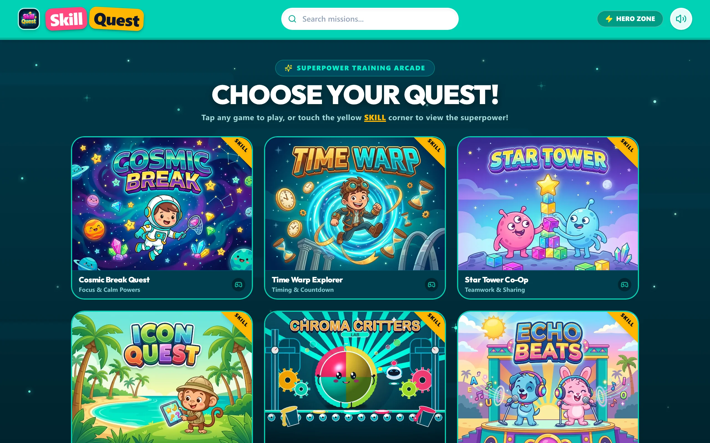
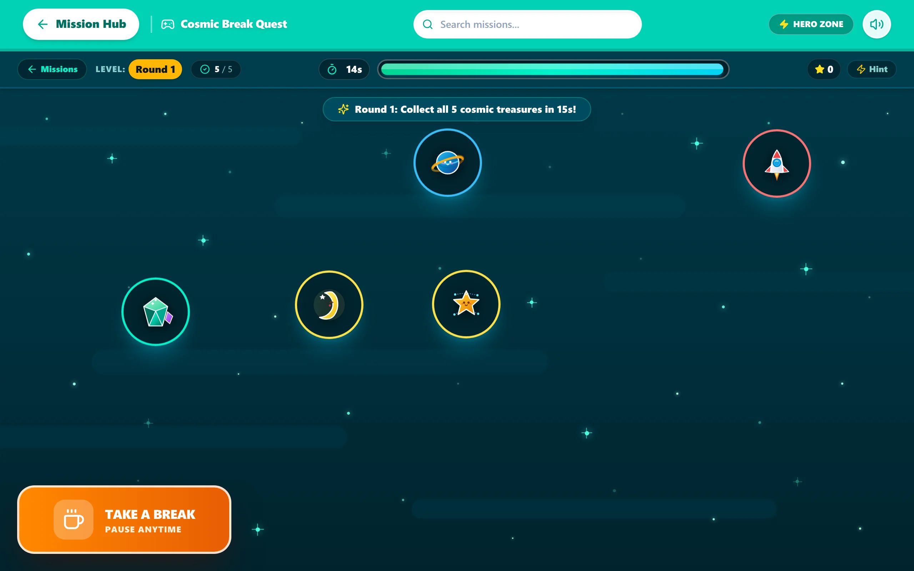
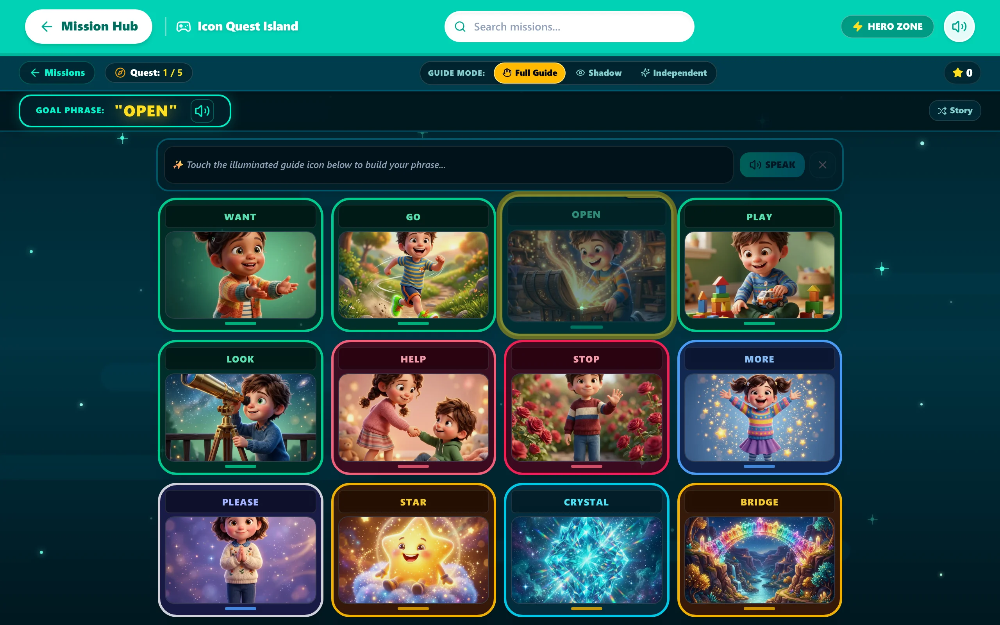
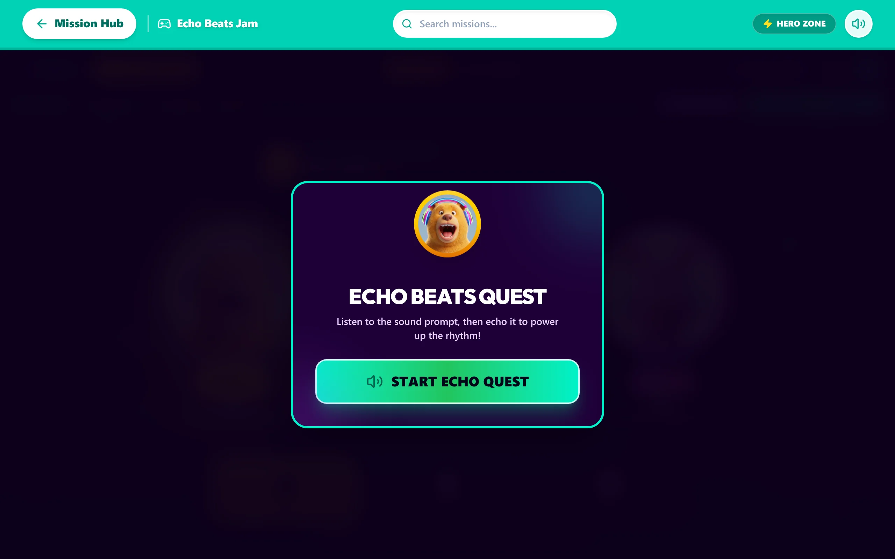
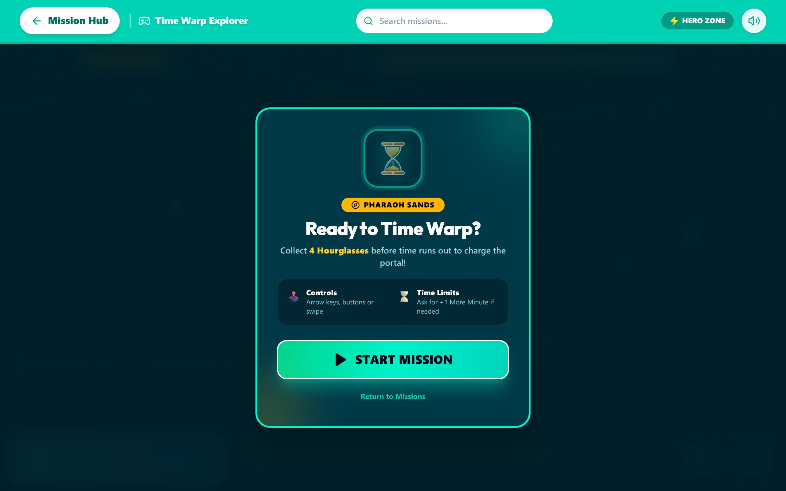

# SkillQuest 🎮✨

[](https://skill-quest.web.app)
[](https://react.dev)
[](https://www.typescriptlang.org)
[](https://tailwindcss.com)
[](https://playwright.dev)
[](https://web.dev/progressive-web-apps/)
[](./LICENSE)

> **Gamified Clinical Skill Acquisition Platform for Pediatric Therapy & Behavior Analysis (ABA / RBT).**  
> SkillQuest bridges clinical behavioral targets with arcade-quality interactive micro-games, transforming repetitive therapy drills into engaging, intrinsically motivating missions.

🔗 **Live Production App:** [https://skill-quest.web.app](https://skill-quest.web.app)

<br />

<div align="center">
  
</div>

---

## 📸 Gameplay & Clinical Modules

<div align="center">
  <table>
    <tr>
      <td width="50%" align="center">
        <strong>Mission 01: Cosmic Break Quest</strong><br />
        <em>Functional Break Request & Escape Extinction</em><br /><br />
        
      </td>
      <td width="50%" align="center">
        <strong>Mission 04: Icon Quest Island</strong><br />
        <em>AAC Symbol Grid & Guided Prompts</em><br /><br />
        
      </td>
    </tr>
    <tr>
      <td width="50%" align="center">
        <strong>Mission 06: Echo Beats Jam</strong><br />
        <em>Vocal Imitation & Echoic Studio</em><br /><br />
        
      </td>
      <td width="50%" align="center">
        <strong>Mission 02: Time Warp Explorer</strong><br />
        <em>Transition Tolerance & Time Extensions</em><br /><br />
        
      </td>
    </tr>
  </table>
</div>

---

## 🎯 Clinical Catalog & Game Modules

SkillQuest organizes 10 clinical learning modules across two specialized operational sectors:

### Sector 1: Behavior & RBT Foundations

| Mission | Game Title | Clinical Target | Skill Code | Therapeutic Mechanism |
| :--- | :--- | :--- | :--- | :--- |
| **01** | **Cosmic Break Quest** | Functional Break Request | `Skill 11` | High task-demand timer (15s) with 25 crystals. Tapping **"Take a Break"** freezes countdown and grants bonus time, reinforcing functional communication over escape-maintained behaviors. |
| **02** | **Time Warp Explorer** | Transition Tolerance & Time Extensions | `Skill 9` | Visual countdown alerts prior to session termination. Tapping **"+1 Minute"** negotiates an extension, mitigating transition meltdowns through proactive communication. |
| **03** | **Star Tower Co-Op** | Turn-Taking & Collaborative Play | `Skills 7 & 8` | Two-player cooperative builder that disables the learner's controls during partner turns, conditioning active waiting and smooth material transfer. |
| **04** | **Icon Quest Island** | AAC Device Fluency & Guidance Acceptance | `Skill 10` | High-frequency AAC symbol grid with tactile desensitization. Rewards physical prompting and symbol discrimination with instant multi-sensory feedback. |
| **05** | **Chroma Critters Lab** | Functional Help-Seeking | `Skill 3` | Multi-layer stencil sequencing puzzle. Introducing impasses prompts players to deploy the **"Help Drone"**, teaching assertive help requests before frustration spikes. |
| **06** | **Echo Beats Jam** | Vocal Imitation & Echoics | `Skills 4 & 12` | Facilitator co-pilot triggers animated character mouth shapes and reinforces immediate phonemic approximations with celebratory rhythm sequences. |
| **07** | **Nebula Memory Vault** | Visual Working Memory & Sustained Attention | `EF 1` | 6-to-20 cosmic capsule grid with 4 difficulty levels (3, 6, 8, 10 pairs). Features 1 or 2-player modes, 3D card flips, penalty-free mismatch resolution, and an RBT co-pilot bar tracking independent vs. prompted (peek) recalls. |

### Sector 2: Cosmic Math Academy

| Quest | Game Title | Mathematical Target | Skill Code | Mechanics & Representation |
| :--- | :--- | :--- | :--- | :--- |
| **01** | **Cosmic Fuel Lab** | Additive Decomposition & Mass Balance | `Math 1` | Calibrate rocket engine reactor cells by combining positive and negative energy units (+1, +5, +10, -2 purge valves) to meet exact ignition targets without arbitrary flashcards. |
| **02** | **Meteor Array Blaster** | Factor Arrays & Geometric Multiplication | `Math 2` | Decompose incoming asteroid swarms into rectangular matrix formations (rows × columns). Features interactive dimension steppers and an arcade 3D Big Red FIRE plunger with vector trajectories. |
| **03** | **Number Forge Alchemist** | Flexible Arithmetic & Recipe Crafting | `Math 3` | Combine elemental reagent runes with arithmetic operations (+, -, ×) in an alchemical cauldron guided by companion Arch-Owl Archimedes, discovering multi-path numerical solutions. |

---

## 📊 RBT & Clinical Analytics Hub

SkillQuest features a dedicated clinical analytics engine designed for therapists, Registered Behavior Technicians (RBTs), and clinical supervisors to measure engagement and adherence in real time:

- **PIN-Protected Security**: Secure 4-digit numeric keypad access with bidirectional cloud synchronization via Firebase Firestore and local offline fallback.
- **Multi-Axis Interactive Charting**:
  - **Horizontal Time Scales**: Instant filtering across **Daily** (today 00:00:00 cutoff), **Weekly** (7-day rolling window), **Monthly** (30-day window), and **Total / All-Time**.
  - **Vertical Axis Metrics**: Toggle seamlessly between **Number of Sessions** and **Play Time (Minutes)**.
  - **Sector Filtering**: Filter statistics by *All Modules*, *Sector 1: Behavior*, or *Sector 2: Math Academy*.
- **Executive Clinical KPIs**: Real-time summary cards displaying Total Play Time, Total Sessions, Favorite Mission, and Active Mission counts.
- **Detailed Usage Breakdown Table**: Granular reporting per game displaying sessions completed, total accumulated minutes, active metric share %, last played timestamp, and high scores.
- **Automated Session Lifecycle Tracking**: Accurate session telemetry powered by 60-second heartbeats, `document.visibilitychange` background pause handling, and `window.beforeunload` active session flushes.
- **Clinical Data Export**: One-click instant exports to **CSV** and **JSON** with ISO timestamps and full granular session histories for clinical binder and IEP documentation.

---

## 🧭 Navigation & Interaction Features

- **Directional Horizontal Sector Transitions**: Switch between Sector 1 and Sector 2 with fluid animated slide transitions via header buttons, lateral screen chevrons, or touch/trackpad swipe gestures.
- **3D Interactive Card Flips**: Tap the yellow **SKILL** ribbon on any game card to flip it in 3D space, revealing clinical target descriptions, IEP codes, and underlying behavioral mechanics.
- **Sensory Audio Controller**: Master sound toggling from the global header powered by a synthesized Web Audio API sound engine, safe for sound-sensitive sensory learners.

---

## ⚡ Tech Stack & Architecture

- **Core Framework:** [React 19](https://react.dev) with strict [TypeScript 5.7](https://www.typescriptlang.org).
- **Styling:** [Tailwind CSS v4](https://tailwindcss.com) utilizing CSS variables and compile-time theme definitions.
- **Database & Sync:** [Firebase Firestore](https://firebase.google.com/docs/firestore) for remote PIN synchronization and session history persistence with offline IndexedDB/LocalStorage caching.
- **Audio & Visual FX:** Web Audio API synthesizer + [Canvas Confetti](https://www.npmjs.com/package/canvas-confetti) for celebratory positive reinforcement.
- **Asset Optimization:** 100% lossy/lossless WebP pipeline (`public/covers/*.webp`, `public/cards/aac/*.webp`) delivering sub-2MB total catalog payload for instant tablet loads.
- **PWA Ready:** Web App Manifest and service worker architecture optimized for clinical tablet deployments.
- **Hosting & CI/CD:** [Firebase Hosting](https://firebase.google.com/docs/hosting) multi-site deployment target (`skill-quest`).

---

## 🚀 Quick Start

### Prerequisites
- Node.js `v20+` (Node `v24` recommended)
- [pnpm](https://pnpm.io/) package manager

### Local Development
```bash
# 1. Clone repository
git clone https://github.com/appflowsolution/SkillQuest.git
cd SkillQuest

# 2. Install dependencies
pnpm install

# 3. Start local dev server (runs on dedicated port 5180)
pnpm run dev
```

Visit `http://localhost:5180` in your browser.

---

## 🧪 Testing Suite (Playwright E2E)

SkillQuest includes **53 automated tests** with 100% pass rate covering user workflows, mathematical integrity, tablet viewports, and persistence:

```bash
# Run all 53 E2E and unit tests headless
pnpm test

# Run tests in interactive UI mode
pnpm run test:ui

# View latest HTML execution report
pnpm exec playwright show-report
```

### Test Coverage Highlights
- **Navigation & Game Flows**: Direct game launching, session exits, multi-player switching, and level selection.
- **Mathematical Boundaries**: Strict date cutoff checks (Daily, Weekly, Monthly), sub-minute playtime handling, and aggregation consistency.
- **Clinical Persistence**: PIN authentication, PIN updating, remote Firestore synchronization, local cache fallbacks, and CSV/JSON export validation.
- **Tablet Viewport Guardrails**: Zero-overflow validation on:
  - **iPad Pro 11"** (`1180x820` Landscape)
  - **iPad 10th Gen** (`1080x810` Landscape)
  - **iPad Mini / Standard** (`1024x768` Landscape)
- **Performance Budgets**: Time-to-content (<400ms) and sub-second game transition benchmarks.

---

## 🚢 Production Deployment

Automated one-command production script with environment detection, build validation, and optional test execution:

```bash
# Standard deployment
./deploy.sh

# Deployment with mandatory E2E test verification
./deploy.sh --with-tests
```

---

## 📄 License

This project is open-source and available under the terms of the [MIT License](./LICENSE).
